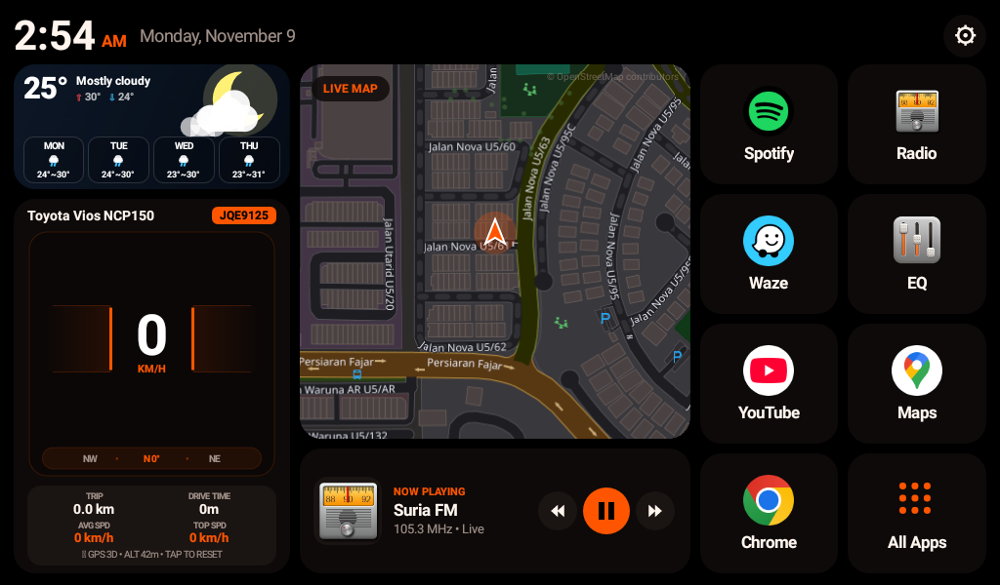

# FusionLauncher (Ember & Black Edition) 🚗🔥

A high-performance, lightweight, and hardware-accelerated Android automotive launcher custom-crafted for the **Toyota Vios NCP150** and **Allwinner T3 / Topway** head units (Android 8.1 / API 27, 1024×600).



---

## ✨ Features

- **Audi Dual-Wing Sport HUD (`SpeedometerGaugeView`)**:
  - Aerodynamic curved dual wings bracketing a high-contrast digital speed readout.
  - Smooth dynamic speed acceleration fill that expands proportionally with GPS speed.
  - Integrated aviation-style rolling compass tape (`W • NW 315° • N`) with live heading and cardinal orientation.
  - One-tap toggle between **KM/H** and **MPH**.
- **Live OpenStreetMap Tile Engine (`LiveMapView`)**:
  - Real-time dark-mode tile rendering centered on vehicle GPS coordinates (`3.174394° N, 101.539155° E`).
  - Dual-provider listener (GPS + Network fallback) with local tile caching.
  - Dynamic speed-adaptive zoom (Street / City / Highway) and rotating vehicle heading cursor.
  - One-tap routing to Google Maps or Waze.
- **Ember & Black Automotive Theme**:
  - Deep pitch black (`#000000`) and rich onyx card backdrops (`#0D0A09`).
  - High-intensity glowing ember orange-red accents (`#FF5500` / `#FF2A00`).
  - Cleaned header with Toyota Vios NCP150 designation, high-contrast license plate badge (`JQE9125`), and dedicated quick Settings gear button (`⚙`).
- **Live Trip Computer**:
  - Real-time GPS distance accumulation (`km`/`mi`).
  - Drive time counter (`m`/`h m`).
  - Real-time average speed and top speed calculations.
  - One-tap statistics reset.
- **Hardware FM Radio & Media Integration**:
  - Live hardware RDS title streaming.
  - Direct Topway MCU hardware key transport commands (prev/next frequency seek, mute/play toggle).
- **Zero-Allocation Rendering Engine**:
  - Completely allocation-free `onDraw()` pipeline (0 B/frame GC pressure) eliminating micro-stutters on low-power automotive SoCs.

---

## 🚀 Building & Compiling

Requirements:
- Android SDK Build-Tools (e.g. 36.0.0 or 27.0.3+)
- Java JDK 8 (`javac`)
- PowerShell

Run the automated 1-click build script:
```powershell
powershell -ExecutionPolicy Bypass -File build.ps1
```
The script will compile the Java sources via `javac`, generate Dalvik bytecode with `d8`, package and align via `aapt2` & `zipalign`, and sign the release APK using `apksigner`.

Output: `FusionLauncher.apk` / `FusionAmber.apk`.

---

## 📲 Wireless ADB Deployment

To install directly to your car head unit over Wi-Fi:
```powershell
powershell -ExecutionPolicy Bypass -File deploy.ps1
```

---

## 📄 License
Developed for Toyota Vios NCP150 Head Unit customization. Free to use and modify.
